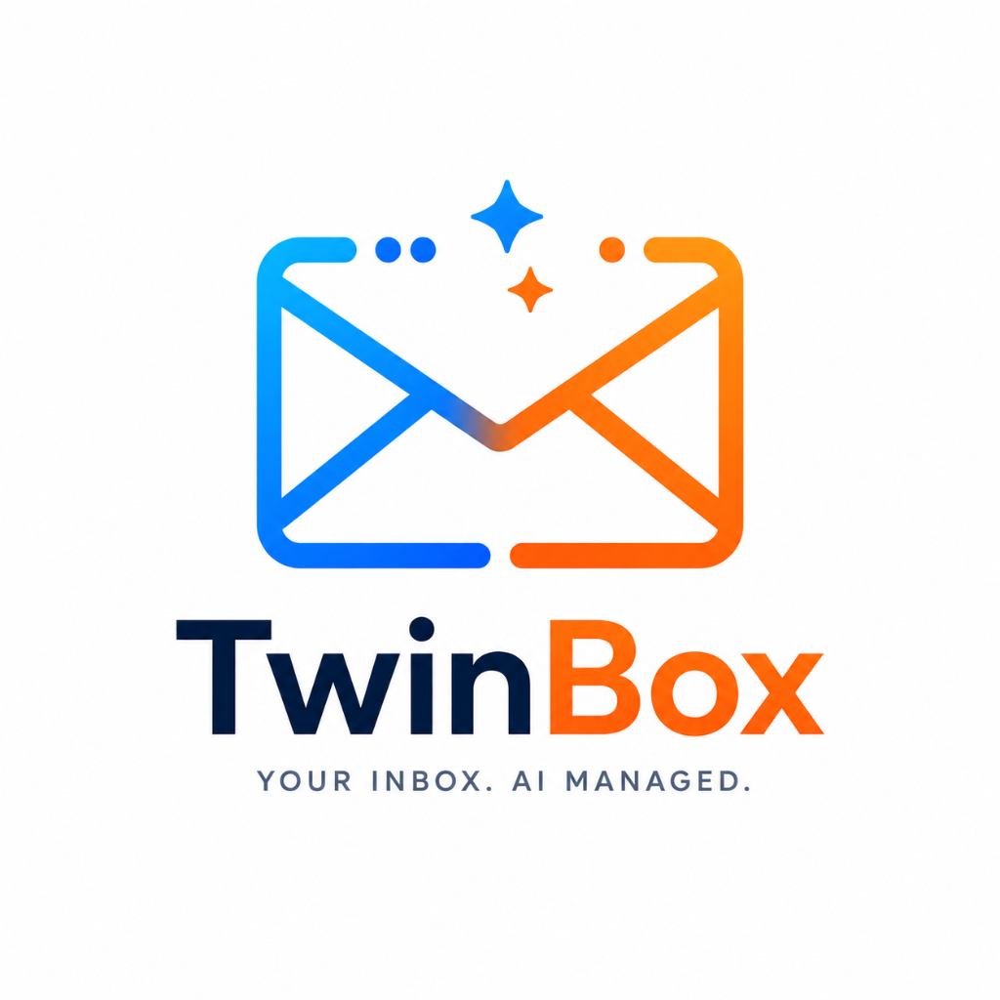

  

<h1 align="center">TwinBox</h1>

  <strong>An AI-powered, privacy-first email parsing, synthesis, and multi-channel notification engine.</strong>

  
  
  

---

## Overview

**TwinBox** is an intelligent assistant designed to summarize incoming emails and push high-fidelity, actionable reports to your preferred notification channels. 

## Key Capabilities

- **Email Ingestion**: Supports direct SMTP ingestion (listening on port `2525`). Native IMAP polling.
- **AI Summarization & Action Extraction**: Integrates with local LLM APIs via LangChain and Ollama.
- **Text-to-Speech (TTS) Reports**: Synthesizes the generated digest into high-quality audio reports.
- **Multi-Channel Dispatch**: Integrates with **Apprise**, supporting over 150+ notification services (e.g., Discord, Slack, Telegram, Matrix, Pushbullet, ntfy, etc.) plus custom Email and WhatsApp endpoints.

---

# Architecture
---

## Project Status

Currently in **Alpha**.

## Flow

1. **Configure Accounts**: Set up your incoming IMAP mail accounts and destination notification channels.
2. **Define Structure**: Establish your target email folders (e.g., Important, Information, AI Spam, Dangerous).
3. **Target Content**: Set up custom IMAP searches and local LLM filters to isolate specific incoming messages.

## Automation

The application ingests your emails locally and automatically triggers processing jobs based on your rules:

*   **Twinbox Generation**: Creates a mirrored, custom view of your inbox populated with AI-generated overviews, thread contexts, and extracted facts.
*   **Smart Routing**: Moves incoming emails to specific, topic-defined folders automatically.
*   **Report Generation**: Writes detailed explanations for filtered emails (e.g., why a message was marked "Suspicious" or "AI Spam").
*   **Digest Creation**: Consolidates multiple related emails or newsletters into unified data summaries.
*   **TTS Overviews**: Converts written email summaries into Text-to-Speech audio overviews.

## Results

*   **Delivery**: All processed summaries, digests, and safety reports are sent directly back to your email inbox or designated notification channels.

## First start

Copy `.env.example` to `.env` and fill in the required values. The admin account is set up like this:

- The first start creates the account `admin` (or `ADMIN_USER`) **without a password of its own**.
- It signs in with `ADMIN_PASSWORD` (12 to 128 characters), or with the contents of the file named by
  `ADMIN_PASSWORD_FILE` (e.g. a Docker secret). There is no default password.
- A banner asks it to set its own password (Account page). From then on `ADMIN_PASSWORD` no longer works for it and
  can be removed from the environment.
- While an account has no password of its own, the server (and so the container) refuses to start without
  `ADMIN_PASSWORD`, or with one that is too short or too long, and logs why.

## 📄 License

This project is licensed under the [MIT License](LICENSE).
